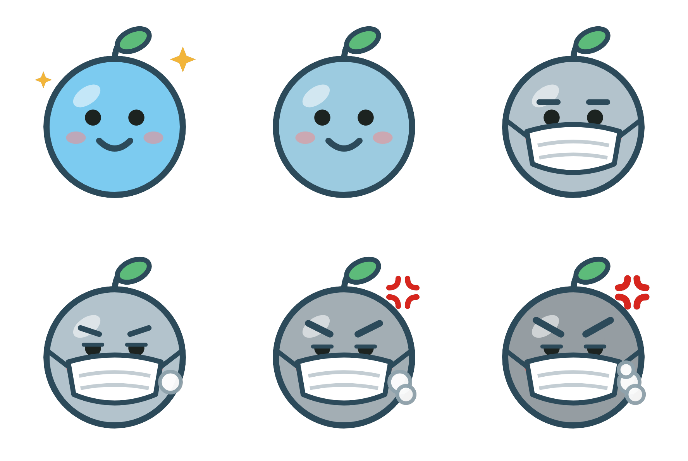

<h1 align="center">Huft!</h1>

<b>Check the air before you head out · Cek udara sebelum keluar</b>

Huft! is a free Android app that shows fire hotspots, smoke and air quality across Indonesia, so you can decide when to go out, when to stay in and how to protect the people you care for. Puff, the mascot, puts on a mask and starts coughing as the air gets worse.

**[⬇ Download Huft! (APK)](https://raw.githubusercontent.com/Far1510/huft/main/releases/Huft.apk)** · Android 5.0 or newer · free, no ads, no account

---

## Fitur · Features

- **Titik api** dari satelit NASA (VIIRS & MODIS), dengan jarak ke lokasi Anda · *Fire hotspots from NASA satellites, with distance from you*
- **Asap & kualitas udara** (US AQI / ISPU) untuk 143 kota, dengan prakiraan 48 jam · *Smoke and air quality for 143 cities, with a 48-hour forecast*
- **Asap di udara** dari Copernicus CAMS · *Wildfire smoke in the whole air column*
- **Awan Himawari** hampir real-time · *Near-live Himawari clouds*
- **Arah angin**, saran kesehatan, tempat favorit · *Wind, health tips, saved places*
- Peta satelit, mode gelap/terang, Bahasa Indonesia & English · *Satellite map, dark/light mode, two languages*

## Cara pasang · How to install

1. Buka link **Download** di atas dari HP Android. · *Open the Download link on your Android phone.*
2. Ketuk file `Huft.apk`, lalu izinkan pemasangan dari browser jika diminta. · *Tap the file and allow installing from your browser if asked.*
3. Android mungkin menampilkan peringatan keamanan karena aplikasi ini tidak berasal dari Play Store. Ikuti langkahnya untuk melanjutkan. · *Android may show a security warning because the app is not from the Play Store; follow the steps to continue.*

**Pembaruan otomatis · Updates:** saat ada versi baru, Huft! menampilkan tombol **Perbarui** di dalam aplikasi. Tidak perlu mengunduh ulang dari sini. · *When a new version is out, Huft! shows an **Update** button inside the app.*

## Sumber data · Data sources

| Data | Source | Terms |
|---|---|---|
| Fire hotspots | [NASA FIRMS](https://firms.modaps.eosdis.nasa.gov/) (LANCE) | Open, attribution |
| Air quality, PM2.5 | [Copernicus CAMS](https://atmosphere.copernicus.eu/) via [Open-Meteo](https://open-meteo.com/) | CC BY 4.0, non-commercial free tier |
| Smoke in the air | Copernicus CAMS, maps by [ECMWF](https://www.ecmwf.int/) | Copernicus licence, attribution |
| Clouds | Himawari-9 (JMA) via [NASA GIBS](https://www.earthdata.nasa.gov/gibs) | Open |
| Wind | [Open-Meteo](https://open-meteo.com/) | CC BY 4.0 |
| Satellite map | [EOxCloudless 2024](https://cloudless.eox.at/) by EOX IT Services GmbH | CC BY-NC-SA 4.0 |
| Street map | [OpenFreeMap](https://openfreemap.org/), © OpenStreetMap contributors | ODbL |
| Terrain | Mapzen Terrain Tiles (AWS Open Data) | Open |
| Borders | [Natural Earth](https://www.naturalearthdata.com/) | Public domain |

Contains modified Copernicus Atmosphere Monitoring Service information. Huft! is free and non-commercial.

Huft! gives general guidance and is not medical advice or an official warning. Follow local authorities and get medical help if breathing becomes difficult.

## Privasi · Privacy

Huft! tidak punya server, tidak meminta akun, dan tidak menyimpan atau mengirim lokasi Anda ke mana pun. Lihat [PRIVACY.md](PRIVACY.md). · *No server, no account, your location never leaves your phone.*

---

© 2026 Far-2026
